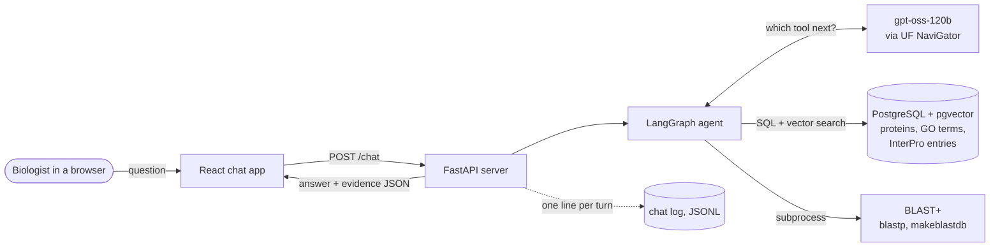
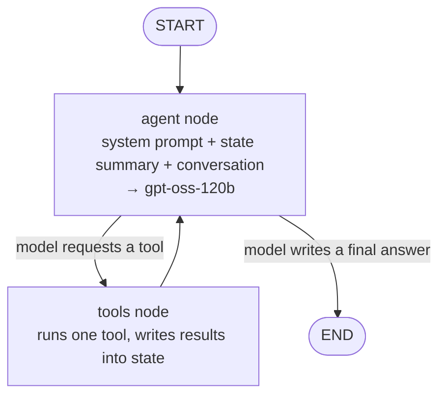
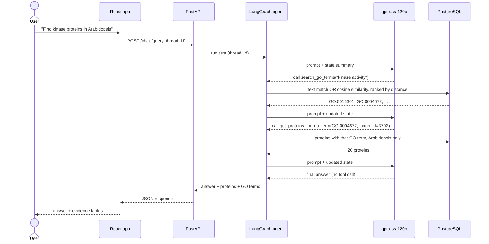
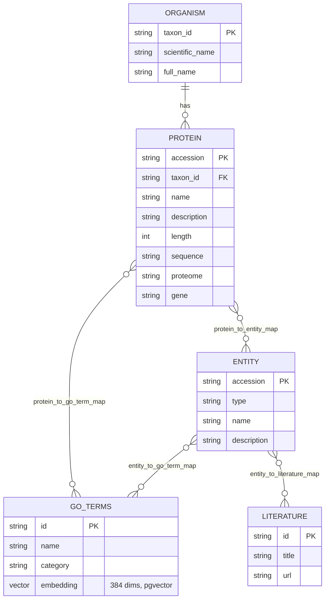
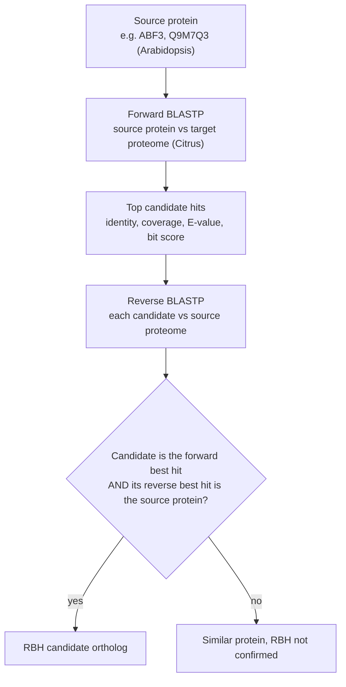
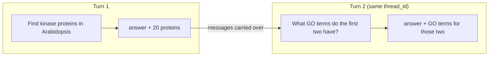

# InterPro Agent

**Ask plant-protein questions in plain English and get answers backed by database evidence.**

InterPro Agent is a conversational research assistant for plant biologists. You type a question such as
*"Find proteins associated with kinase activity in Arabidopsis"* or *"What is the Citrus counterpart of ABF3?"*,
and an LLM agent decides which database lookups to run, runs them, and answers with a written summary plus
tables of the exact proteins, Gene Ontology (GO) terms, InterPro entries and BLAST results it used.

It was built in the Plant Pathology department at the University of Florida as one of several specialist agents
for bioinformatics and genome mining. It currently runs as a pilot for lab members.

---

## Contents

- [What it can do](#what-it-can-do)
- [How it works](#how-it-works)
- [The agent workflow](#the-agent-workflow)
- [Tools the agent can use](#tools-the-agent-can-use)
- [The database](#the-database)
- [Ortholog analysis with BLAST](#ortholog-analysis-with-blast)
- [Conversation memory](#conversation-memory)
- [API](#api)
- [Repository layout](#repository-layout)
- [Running it locally](#running-it-locally)
- [Known limitations](#known-limitations)
- [Roadmap](#roadmap)
- [Credits](#credits)

---

## What it can do

| You ask | The agent |
|---|---|
| *Find proteins associated with GO:0004672 in Arabidopsis* | Looks up the GO term and lists Arabidopsis proteins annotated with it |
| *Find proteins associated with kinase activity* | Finds matching GO terms by meaning (vector search), then the proteins annotated with them |
| *What GO terms does A0A178UCT8 have?* | Returns the protein's GO annotations with names and categories |
| *Which InterPro domains are in this protein?* | Lists the InterPro entries (families, domains, sites) linked to it |
| *What is the accession number of ABF3 in Citrus sinensis?* | Finds ABF3 in Arabidopsis, runs a reciprocal BLAST search against the Citrus proteome, and reports candidate orthologs with identity, coverage and E-values |
| *What GO terms do the first two have?* (a follow-up) | Remembers the earlier answer in the same conversation |

Every answer comes with collapsible **evidence tables** built from the database rows the agent actually retrieved,
with links to [UniProt](https://www.uniprot.org/), [QuickGO](https://www.ebi.ac.uk/QuickGO/) and
[InterPro](https://www.ebi.ac.uk/interpro/). The written answer is the model's summary; the tables are the source of truth.

**Organisms:** *Arabidopsis thaliana* (taxon 3702) and *Citrus sinensis* (taxon 2711).

---

## How it works



| Layer | Technology | Role |
|---|---|---|
| Frontend | React 19, TypeScript, Vite | Chat interface, markdown answers, evidence tables |
| API | FastAPI, uvicorn | `POST /chat`; also serves the built frontend in production |
| Agent | LangGraph, LangChain | Tool-calling loop, shared state, conversation memory |
| LLM | `gpt-oss-120b` through UF's NaviGator Toolkit (OpenAI-compatible API) | Chooses tools and writes the answer |
| Data | PostgreSQL 17 with pgvector | Proteins, GO terms, InterPro entries, literature, embeddings |
| Embeddings | `sentence-transformers/all-MiniLM-L6-v2` (384 dimensions) | Semantic search over GO term names |
| Sequence analysis | NCBI BLAST+ | Reciprocal-best-hit ortholog search |

---

## The agent workflow

The agent is a [LangGraph](https://langchain-ai.github.io/langgraph/) state graph with two nodes. The **agent** node
asks the model what to do next; the **tools** node runs whatever database tool the model chose. They loop until the
model answers instead of calling a tool.



What makes it work:

- **Shared state.** Tools don't just return text to the model. They write structured results (`proteins`,
  `go_terms`, `entities`, `ortholog_results`) into the graph state, and return a short receipt message. Custom
  reducers merge results from several tool calls and remove duplicates by accession or GO ID.
- **State summary in every step.** Before each model call, a compact JSON summary of the state (IDs, names,
  organisms, GO term names) is added to the system prompt, so the model reasons over real retrieved data instead of
  recalling facts from memory.
- **One tool at a time.** Tool calls are sequential (`parallel_tool_calls=False`), which keeps multi-step plans in order.
- **Errors become messages.** If a tool fails (for example BLAST is missing), the error is passed back to the model
  so it can explain the problem instead of crashing the request.
- **Organism filters run in the database.** Protein tools take an optional `taxon_id` that is applied *before* the
  result limit, so "in Arabidopsis" returns Arabidopsis proteins rather than a filtered slice of mixed results.

### One question, step by step



---

## Tools the agent can use

| Tool | What it does |
|---|---|
| `get_protein` | Full record for one protein accession |
| `search_proteins` | Text search on protein name, gene and description (optional organism filter) |
| `get_go_term` | One GO term by ID |
| `search_go_terms` | Finds GO terms by name match **or** meaning (pgvector cosine similarity), ranked by relevance |
| `get_go_terms_for_protein` | All GO annotations of a protein |
| `get_proteins_for_go_term` | Proteins annotated with a GO term (optional organism filter) |
| `get_entity` | One InterPro entry by accession |
| `search_entities` | Text search on InterPro entry names and descriptions (optional type filter) |
| `get_entities_for_protein` | InterPro entries linked to a protein |
| `get_proteins_for_entity` | Proteins linked to an InterPro entry (optional organism filter) |
| `analyze_orthologs` | Reciprocal-best-hit BLAST search for a protein's counterparts in the other organism |

The system prompt contains tool-selection rules (which tool for which kind of question), organism rules, and answer
rules, for example: report results as candidates when they are, say when a list is a partial slice, and state GO term
names only when a tool returned them.

---

## The database

The agent answers from a local PostgreSQL database derived from UniProt and InterPro data for the two organisms.

| Table | Rows | Contents |
|---|---:|---|
| `protein` | 179,281 | Accession, name, description, length, sequence, proteome, gene, organism |
| ↳ *Arabidopsis thaliana* (3702) | 54,646 | |
| ↳ *Citrus sinensis* (2711) | 124,635 | |
| `entity` | 54,189 | InterPro entries: families, domains, repeats, sites, homologous superfamilies |
| `go_terms` | 5,590 | GO terms referenced by these proteins and entries, with a 384-dimensional embedding |
| `organism` | 2 | Taxon ID, scientific name |
| `literature` | 65,466 | Publications linked to InterPro entries |



**Semantic GO search.** Each GO term name is embedded with MiniLM (`backend/backfill_embeddings.py`). At query time
the user's phrase is embedded the same way, and `search_go_terms` combines name matches with nearest neighbours by
cosine distance, so *"kinase activity"* finds `GO:0016301` and `GO:0004672` first, and paraphrases still match.

**Scope notes.** The data is a snapshot (2026). GO annotations are the *direct* annotations stored for each protein; the
GO hierarchy is not included, so a general term returns only proteins annotated with exactly that term. The database
dump is not part of this repository.

---

## Ortholog analysis with BLAST

`analyze_orthologs` finds candidate counterparts of a protein in the other organism using **reciprocal best hits (RBH)**,
entirely locally with BLAST+ and sequences from the database.



For ABF3, this yields one RBH candidate in Citrus (`A0A067F0W3`, 48.6% identity, E-value 4e-114) and nine similar
proteins. RBH results are candidate orthologs, not proof of orthology, and the interface says so under every ortholog table.

---

## Conversation memory

Follow-up questions work within a conversation. The browser creates a random `thread_id` and sends it with every
question; LangGraph's checkpointer stores the conversation per thread.



- **Messages persist** across turns, so the model can resolve "the first two".
- **Evidence resets every turn**, so each answer's tables show only what that answer retrieved.
- **New chat** in the interface starts a new thread. Memory is held in server memory and clears when the server restarts.

---

## API

`POST /chat`

```json
{ "query": "Find proteins associated with GO:0004672 in Arabidopsis", "thread_id": "8f3c…" }
```

Response:

```json
{
  "answer": "markdown text",
  "query_protein": null,
  "proteins":   [{ "accession": "A0A178UR90", "taxon_id": "3702", "name": "…", "gene": "CIPK21",
                   "length": "…", "go_terms": ["GO:0004672"], "go_term_names": {"GO:0004672": "protein kinase activity"},
                   "entities": ["IPR…"], "…": "…" }],
  "go_terms":   [{ "id": "GO:0004672", "name": "protein kinase activity", "category": "molecular_function", "proteins": [] }],
  "entities":   [{ "accession": "IPR…", "type": "domain", "name": "…", "literatures": [], "proteins": [] }],
  "ortholog_results": [{ "source_accession": "Q9M7Q3", "target_organism": "Citrus sinensis",
                         "rbh_count": 1, "results": [], "caveat": "…" }]
}
```

Errors return an HTTP status with `{"detail": "message"}` (422 when a question needs too many steps, 500 for agent
failures). The full TypeScript contract is in [`frontend/src/types.ts`](frontend/src/types.ts).

Each turn is also appended to `backend/logs/chat.jsonl` (question, answer, tool calls, timing, errors) for debugging
and evaluation. The log directory is git-ignored.

---

## Repository layout

```
backend/
  adv_agent.py            LangGraph agent: models, state, 11 tools, system prompt, graph
  adv_server.py           FastAPI app: POST /chat, logging, serves frontend/dist
  main.py                 Command-line smoke test of the agent
  backfill_embeddings.py  Adds and fills go_terms.embedding (idempotent)
  requirements.txt        Pinned Python dependencies
  agent.py, server.py, db.py   Earlier prototype (router design); kept for history, not used
frontend/
  src/types.ts            API contract
  src/api.ts              askQuestion(query, threadId)
  src/App.tsx             Conversation state, New chat
  src/components/         MessageList, MessageBubble, Composer, evidence tables
```

---

## Running it locally

**Prerequisites:** Python 3.12+, Node.js 20.19+, Docker, BLAST+ (`blastp`, `makeblastdb` on your PATH), a copy of
the database dump, and an API key for an OpenAI-compatible endpoint (the code uses UF NaviGator and `gpt-oss-120b`).

**1. Database** (PostgreSQL 17 with pgvector, in Docker)

```bash
docker run -d --name interpro-pg -e POSTGRES_PASSWORD='choose-one' \
  -p 127.0.0.1:5432:5432 -v interpro-pgdata:/var/lib/postgresql/data \
  -v "$PWD/dumps":/dump:ro pgvector/pgvector:pg17
docker exec interpro-pg createdb -U postgres interpro
docker exec interpro-pg pg_restore -U postgres -d interpro --no-owner --no-privileges /dump/interpro.dump
```

If your dump has no GO embeddings yet, run `python backend/backfill_embeddings.py` once after setting up step 2.

**2. Configuration**: create `.env` in the repository root (never commit it):

```
DATABASE_URL=postgresql+psycopg2://postgres:<password>@127.0.0.1:5432/interpro
OPENAI_API_KEY=<your NaviGator / OpenAI-compatible key>
```

Optional: `CHAT_LOG_PATH` to move the chat log.

**3. Backend**

```bash
python3 -m venv .venv
.venv/bin/pip install -r backend/requirements.txt
cd backend
../.venv/bin/python main.py                       # smoke test: prints tool calls and an answer
../.venv/bin/uvicorn adv_server:app --port 8000   # API on http://localhost:8000
```

On Linux without a GPU, install the CPU build of PyTorch first to avoid a multi-GB CUDA download:
`pip install torch --index-url https://download.pytorch.org/whl/cpu`.

**4. Frontend**

```bash
cd frontend
npm install
echo "VITE_API_URL=http://localhost:8000" > .env
npm run dev                                        # http://localhost:5173
```

**Production-style, single URL:** `npm run build` in `frontend/`; the FastAPI server then serves `frontend/dist`
at `/` next to `/chat`, so one `uvicorn` process serves the whole app.

---

## Known limitations

- **The LLM can still be wrong.** It sometimes paraphrases numbers from the tool results incorrectly or adds general
  biology that is not in the database. The evidence tables come straight from the database and are the reference.
- **Results are slices.** Tools return at most 20–100 rows; a GO term can have thousands of proteins. The agent is
  instructed to say when a list is partial.
- **Two organisms only**, and no GO hierarchy (see [The database](#the-database)).
- **Ortholog searches rebuild BLAST databases on each call** (about 15–30 seconds).
- **Memory is in-process**: conversations clear on restart, and the server runs as a single worker.
- **No authentication or rate limiting** on `/chat` yet.

---

## Roadmap

- **Evaluation framework:** generate questions with answer keys computed from the database, run them against the
  agent repeatedly, and score factual accuracy, completeness, tool use and reliability; designed to evaluate the
  lab's other agents too.
- History trimming for long conversations, and durable memory (`PostgresSaver`).
- Reuse prebuilt BLAST databases instead of rebuilding them per query.
- Authentication or rate limiting; service management and backups for the deployment.
- A common request/response contract so this agent can sit behind a lab-wide router with other specialist agents.

---

## Credits

- **Harsh Khanna** designed and built the original agent, tools and database.
- **Tikaharu Sharma** currently maintains the project: the web frontend, deployment, conversation memory, and fixes to
  retrieval, GO search and ortholog scoring.
- Developed in the lab of **Dr. Jose Huguet-Tapia**, Department of Plant Pathology, University of Florida.
- Data from [UniProt](https://www.uniprot.org/), [InterPro](https://www.ebi.ac.uk/interpro/) and the
  [Gene Ontology](https://geneontology.org/). LLM access through the UF NaviGator Toolkit.
